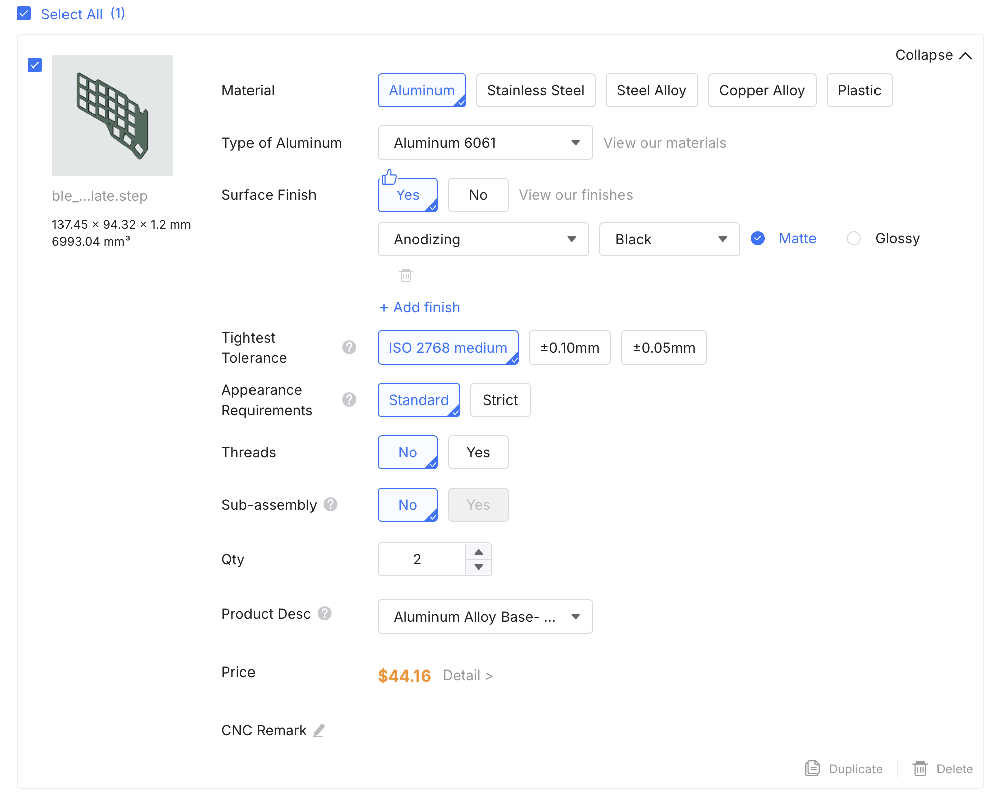

# Boardsource Wireless Switch Plate Files

Custom switch plate files for the **Boardsource Unicorne** keyboard, adapted for wireless (BLE) builds. This repository contains KiCad project files and exported DXF plots ready for fabrication.

These files were based on and modified from the original Boardsource open hardware repository:
[boardsource/open-files](https://github.com/boardsource/open-files/tree/master)


## Available BLE Switch Plates

| Plate                                | Description                                            | KiCad File                        | DXF Plot                               |
| ------------------------------------ | ------------------------------------------------------ | --------------------------------- | -------------------------------------- |
| **BLE Plate with screen cutouts**    | Wireless plate with cutouts for a small screen/display | `Kicad/ble_plate_scr.kicad_pcb`   | `Ble Plate Plots/ble_plate_screen.dxf` |
| **BLE Plate without screen cutouts** | Wireless plate with a clean layout, no screen cutout   | `Kicad/ble_plate.kicad_pcb`       | `Ble Plate Plots/ble_plate.dxf`        |
| **Original Unicorne Plate**          | The standard Unicorne switch plate layout              | `Kicad/uni_corne_plate.kicad_pcb` | `uni_corne_default_plate.dxf`          |
| **Legacy Unicorne Plate**            | The original legacy Unicorne plate layout              | —                                 | `uni_corne_legacy_plate.dxf`           |

## File Structure

```
boardsource-wireless-plate-files/
├── Kicad/                        # KiCad PCB project files
│   ├── ble_plate.kicad_pcb       # BLE plate (no screen)
│   ├── ble_plate_scr.kicad_pcb   # BLE plate (with screen cutout)
│   └── uni_corne_plate.kicad_pcb # Original Unicorne plate
├── Ble Plate Plots/              # Exported files for fabrication
│   ├── ble_plate.dxf
│   ├── ble_plate_screen.dxf
│   └── uni_corne_plate_screen.dxf
├── uni_corne_default_plate.dxf   # Original Unicorne plate (DXF)
└── uni_corne_legacy_plate.dxf    # Legacy Unicorne plate (DXF)
```

## Usage

- **KiCad files** (`.kicad_pcb`) can be opened with [KiCad EDA](https://www.kicad.org/) for editing or generating manufacturing files.
- **DXF files** can be used directly for laser cutting or sent to a PCB fabrication service.

## CNC Machining

The `.step` files in this repo are ready to be ordered via **[JLCPCB CNC Machining](https://jlcpcb.com/cnc-machining)**.

**Recommended settings:**
- **File format**: Upload the `.step` file under *3D Machining*
- **Material**: FR4 (1.2 mm) or Aluminum (1.2 mm)
- **Thickness**: 1.2 mm
- **Surface finish**: Anodized (if Aluminum) or leave as default

> [!NOTE]
> If your design includes **threaded holes**, you must also upload a `.dxf` drawing alongside the `.step` file so JLCPCB can correctly identify thread specs.


