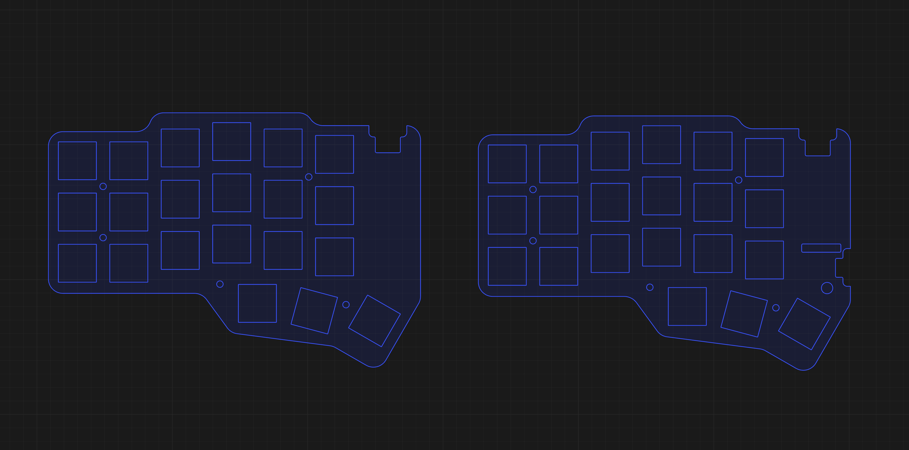
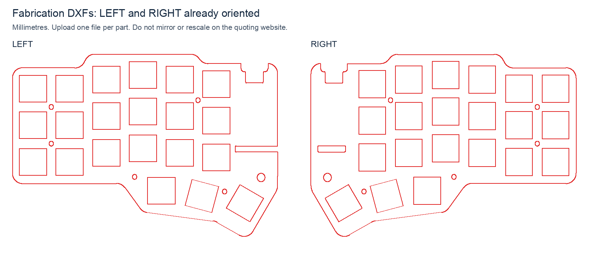
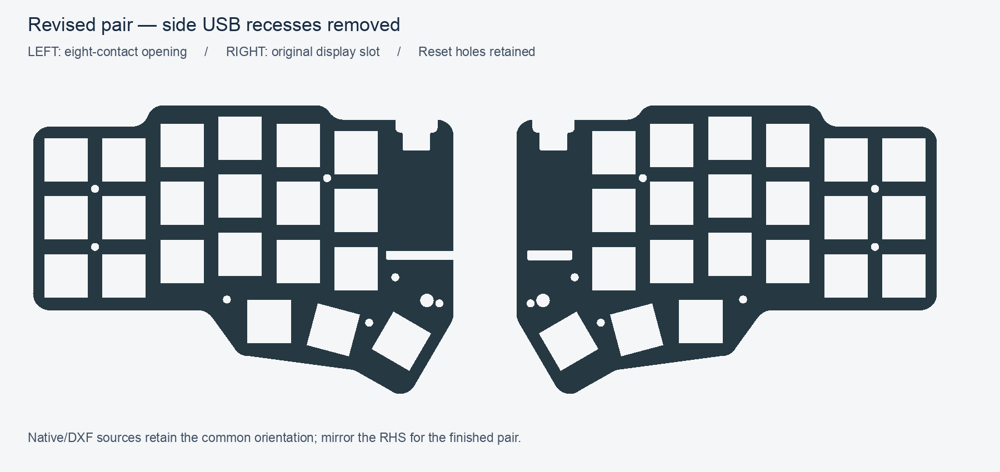
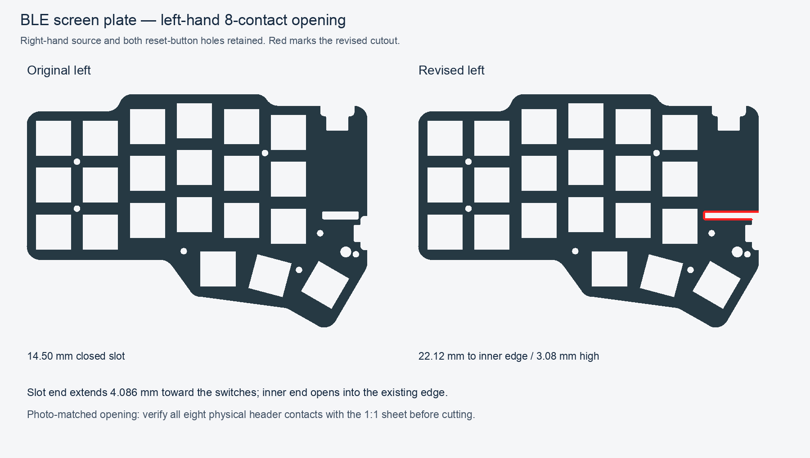

# Boardsource Wireless Switch Plate Files

Custom switch plate files for the **Boardsource Unicorne** keyboard, adapted for wireless (BLE) builds. This repository contains KiCad project files and exported DXF plots for fabrication workflows. The revised LHS/RHS pair is a draft pending the physical print-template check.

These files were based on and modified from the original Boardsource open hardware repository:
[boardsource/open-files](https://github.com/boardsource/open-files/tree/master)



> [!NOTE]
> See the plates in usage on my custom [Corne Build](https://github.com/WillACosta/zmk_bs_corne_firmware/tree/feat/zmk_custom_firmware)

## Aluminum cutting files

Use [LEFT-aluminum-plate-mm.dxf](fabrication/dxf/LEFT-aluminum-plate-mm.dxf) and [RIGHT-aluminum-plate-mm.dxf](fabrication/dxf/RIGHT-aluminum-plate-mm.dxf) for quoting. Both are in millimetres, at actual size, with the right half **already mirrored**. Do not mirror them again on the vendor website. Upload one file per part and select the desired aluminum alloy, thickness and finish separately. Plate fit and thickness still require your physical check. [Cutting-file notes](fabrication/dxf/README.md)



## Available BLE Switch Plates

| Plate                                | Description                                            | KiCad File                        | DXF Plot                               |
| ------------------------------------ | ------------------------------------------------------ | --------------------------------- | -------------------------------------- |
| **BLE Plate with screen cutouts**    | Wireless plate with cutouts for a small screen/display | `Kicad/ble_plate_scr.kicad_pcb`   | `Ble Plate Plots/ble_plate_screen.dxf` |
| **BLE screen plate — LHS eight-contact opening** | Extended, open-ended header slot for StenoSquid; side USB recess filled | `Kicad/ble_plate_scr_lhs_8pin.kicad_pcb` | `Ble Plate Plots/ble_plate_screen_lhs_8pin.dxf` |
| **BLE screen plate — RHS without side USB recess** | Original display slot; side USB recess filled; mirror for RHS | `Kicad/ble_plate_scr_rhs_no_side_usb.kicad_pcb` | `Ble Plate Plots/ble_plate_screen_rhs_no_side_usb.dxf` |
| **BLE Plate without screen cutouts** | Wireless plate with a clean layout, no screen cutout   | `Kicad/ble_plate.kicad_pcb`       | `Ble Plate Plots/ble_plate.dxf`        |
| **Original Unicorne Plate**          | The standard Unicorne switch plate layout              | `Kicad/uni_corne_plate.kicad_pcb` | `uni_corne_default_plate.dxf`          |
| **Legacy Unicorne Plate**            | The original legacy Unicorne plate layout              | —                                 | `uni_corne_legacy_plate.dxf`           |

## File Structure

The new LHS opening is **22.12 mm to the inner edge × 3.08 mm high**, with a rounded switch-facing end. The large reset-button holes and the two small marked holes on each revised half are removed. This is a photo-matched mechanical draft; check the [actual-size sheet](assets/ble-plate-lhs-8pin-1to1.svg) on the physical host before cutting. Both new variants fill the side USB recess while retaining the top USB notch. The original screen plate/DXF remain unchanged as a baseline. The native RHS and older source DXF retain the common source orientation. The files under `fabrication/dxf/` are the ready-oriented cutting exports; use those for quoting. The revised [1.2 mm STEP pair](fabrication/step/) matches these cutting files. [Dimensions and checks](docs/lhs-eight-contact-opening.md) · [Print-ready 1:1 PDF](output/pdf/ble-plates-1to1-fit-check.pdf) · [Manufacturing options](docs/manufacturing-options.md)





```
boardsource-wireless-plate-files/
├── Kicad/                        # KiCad PCB project files
│   ├── ble_plate.kicad_pcb       # BLE plate (no screen)
│   ├── ble_plate_scr.kicad_pcb   # BLE plate (with screen cutout)
│   └── uni_corne_plate.kicad_pcb # Original Unicorne plate
├── Ble Plate Plots/              # Exported files for fabrication
│   ├── ble_plate.dxf
│   ├── ble_plate_screen.dxf
│   └── uni_corne_plate_screen.dxf
├── uni_corne_default_plate.dxf   # Original Unicorne plate (DXF)
└── uni_corne_legacy_plate.dxf    # Legacy Unicorne plate (DXF)
```

## Usage

- **KiCad files** (`.kicad_pcb`) can be opened with [KiCad EDA](https://www.kicad.org/) for editing or generating manufacturing files.
- **DXF files** can be used directly for laser cutting or sent to a PCB fabrication service.

## JLCCNC quote

Upload the revised [left STEP](fabrication/step/LEFT-aluminum-plate-1p2mm.step) and [right STEP](fabrication/step/RIGHT-aluminum-plate-1p2mm.step) as separate parts. The right model is already mirrored. Both are 1.2 mm solid models of the current outlines, with the reset holes removed.

For these flat plates, start with [JLCCNC Sheet Metal](https://jlccnc.com/sheet-metal-fabrication) and specify 1.2 mm 5052 aluminum with black anodizing. Confirm those selections in the quote. [Will's original README](https://github.com/WillACosta/boardsource-wireless-plate-files#cnc-machining) recommends 1.2 mm aluminum and anodizing through the 3D Machining workflow. The legacy STEP files under `Ble Plate Plots/` cover the previous geometry.
